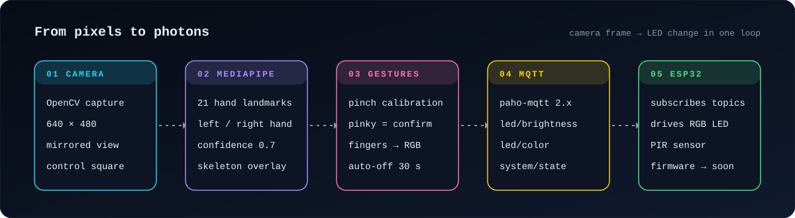

<picture>
  <source media="(prefers-color-scheme: dark)" srcset="./docs/assets/header-dark.svg">
  <source media="(prefers-color-scheme: light)" srcset="./docs/assets/header-light.svg">
  
</picture>

<p align="center">
  
  
  
  
  
</p>

```text
$ python -m gesture_led_control --broker 10.42.0.1
[mqtt]     Connected successfully
[state]    CALIBRATION: Pinch, OK=Pinky        → MIN: 24 px
[state]    CALIBRATION: Stretch out, OK=Pinky  → MAX: 168 px
[right]    pinch 96 px  → APPROVED 50%          → project/led/brightness  "50"
[left]     index+middle → APPROVED (255,255,0) → project/led/color       "255,255,0"
[idle 30s] AUTO SHUTDOWN                         → project/system/state    "off"
```

**Control the room lights with your hands.** A webcam watches your hand, MediaPipe turns it into 21 landmarks, and a small state machine reads gestures from them. The right hand sets brightness with a pinch, and the left hand picks an RGB colour by raising fingers. Each confirmed change goes over MQTT to an ESP32 that drives the LEDs.

## ✋ Gestures

| Hand | Gesture | Effect |
|---|---|---|
| Right | **pinch** thumb and index closer or wider | brightness 0–100 % (10 % steps) |
| Right | **bend the pinky** | confirm (calibration point, or publish brightness) |
| Left | **raise index / middle / ring** | red / green / blue channel on |
| Left | **fold the thumb** | publish the colour |
| — | no gesture for **30 s** | lights off, app exits |

Gestures only count inside the **control square** in the middle of the frame. It turns green while a hand is being read, so a hand scratching your head off-screen doesn't change anything.

**First run is a 2-step calibration** with the right hand: pinch tightly and bend the pinky (minimum distance), then spread wide and bend the pinky again (maximum). Brightness is then mapped onto *your* hand and *your* distance from the camera.

## 🛰️ How it works

<picture>
  <source media="(prefers-color-scheme: dark)" srcset="./docs/assets/pipeline-dark.svg">
  <source media="(prefers-color-scheme: light)" srcset="./docs/assets/pipeline-light.svg">
  
</picture>

```
CALIBRATE_MIN ──pinky──▶ CALIBRATE_MAX ──pinky (max > min)──▶ ACTIVE
      ▲                         │
      └──── pinky (max ≤ min) ──┘   "ERROR: MIN>MAX"
```

### MQTT topics

| Topic | Payload | When |
|---|---|---|
| `project/led/brightness` | `0`…`100` | right hand confirms a new brightness |
| `project/led/color` | `r,g,b` (each `0` or `255`) | left hand confirms a new colour |
| `project/system/state` | `on` / `off` | app start; `q` or 30 s inactivity |

## 🔍 Design notes

- **"Is a finger bent?" without angles.** A finger counts as bent when its tip is closer to the wrist than its middle joint. That's one squared-distance comparison per finger and it doesn't depend on how the hand is rotated.
- **The thumb is measured from the palm centre**, which is the midpoint of the wrist and the ring-finger base, rather than from the wrist. The thumb folds sideways, so the wrist rule doesn't work for it.
- **Edge-triggered confirmations.** A command fires on the frame where the finger *becomes* bent, not on every frame while it stays bent, so holding a gesture never floods the broker.
- **Deduplication.** Unchanged values aren't re-published, at both the gesture level and the MQTT client level.
- **Works offline.** If the broker is down, gestures still work and the overlay says `OFFL APPROVED`. The paho network loop keeps reconnecting in the background, and the overlay shows `MQTT Enabled` once it's back.
- **Brightness snaps to 10 % steps**, so jitter in the landmarks doesn't make the light flicker.

## 🚀 Run it

```bash
pip install -r requirements.txt
python -m gesture_led_control                       # broker 10.42.0.1:1883, camera 0
python -m gesture_led_control --broker 192.168.1.50 --camera 1
```

`GLC_MQTT_BROKER`, `GLC_MQTT_PORT` and `GLC_CAMERA_INDEX` environment variables work too. The default `10.42.0.1` is the address of a Linux (NetworkManager) Wi-Fi hotspot, which is a handy way to put the laptop, broker and ESP32 on one network. Press `q` to quit.

Debug the ESP32 side without the camera:

```bash
mosquitto_sub -h 10.42.0.1 -t 'project/#' -v       # watch what the app sends
mosquitto_pub -h 10.42.0.1 -t project/led/color -m "0,255,255"
```

### Tests

The gesture logic and MQTT client are tested with synthetic landmarks, so no camera or broker is needed:

```bash
pip install -r requirements-dev.txt
python -m pytest
```

## 🔌 Hardware & firmware

The ESP32 subscribes to the topics above and drives the LEDs; a PIR motion sensor is part of the setup. The firmware and wiring will be added to `firmware/` soon.

## 🗂️ Repository

```
gesture_led_control/
├── __main__.py        CLI entry point
├── config.py          camera, control square, landmark indices, MQTT topics
├── hand_detector.py   MediaPipe Hands wrapper
├── geometry.py        finger-bent test, control-square test, distances
├── gesture_system.py  state machine, gesture handlers, overlay, main loop
└── mqtt_client.py     paho-mqtt publisher with offline mode
tests/                 gesture and MQTT tests (no camera needed)
docs/assets/           README graphics
```
